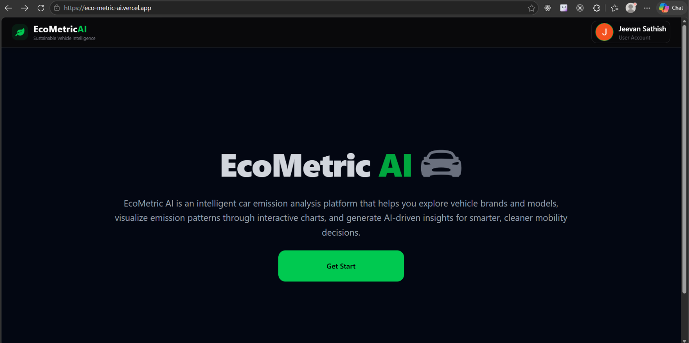
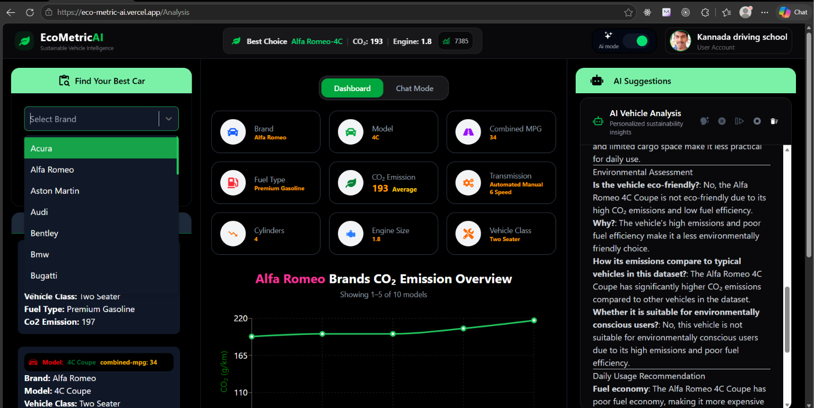
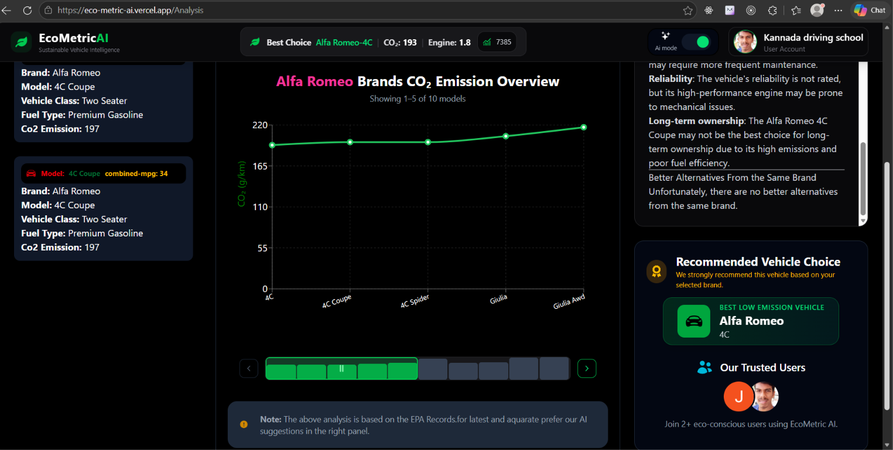
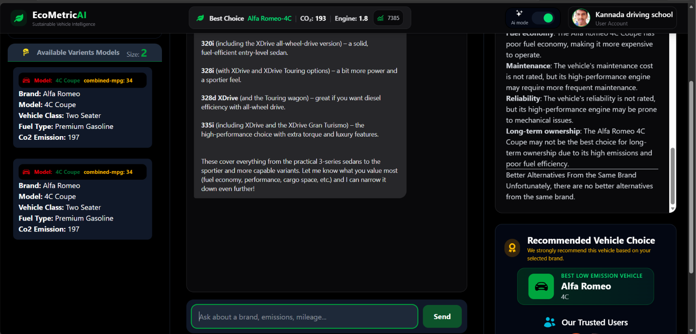
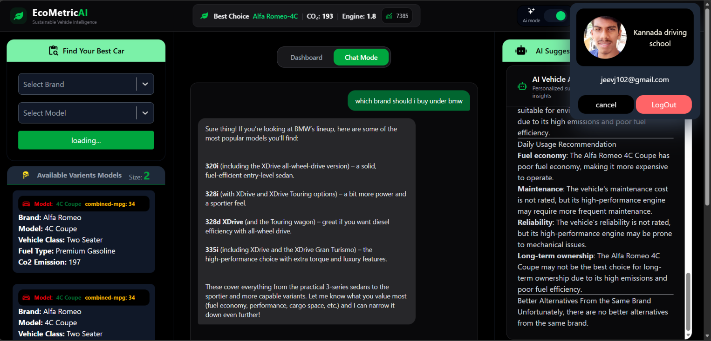

# 🌱 EcoMetricAI – AI-Powered Vehicle CO₂ Emissions Analytics

**EcoMetricAI** is a full-stack web application designed to analyze vehicle carbon emissions, explore vehicle performance data, and provide AI-powered recommendations to help users make environmentally conscious decisions.

🚀 **Live Demo:** https://eco-metric-ai.vercel.app/

---

## 📸 Application Screenshots

### 1. Entry Point – Home Page

<!-- Replace with your home page screenshot -->



### 2. User Authentication – Login

<!-- Replace with your login screenshot -->


### 3. Dashboard

<!-- Replace with your dashboard screenshot -->



### 4. Data Analytics

<!-- Replace with your analytics screenshot -->



### 5. AI-Powered Custom Chatbot

<!-- Replace with your chatbot screenshot -->



### 6. Logout

<!-- Replace with your logout screenshot -->



---

## ✨ Key Features

- **Secure Authentication:** JWT-based authentication with access and refresh token handling.
- **Vehicle CO₂ Analytics:** Explore and analyze vehicle emission datasets.
- **Interactive Dashboard:** Visualize vehicle emission insights through interactive charts and analytics.
- **AI-Powered Suggestions:** Integrated Groq LLaMA models to generate intelligent vehicle-related recommendations.
- **Custom AI Chatbot:** Interact with an AI assistant to explore vehicle emissions and related insights.
- **Caching:** Improved data retrieval performance using caching mechanisms.
- **Email Notifications:** Automated email notification pipeline using cron jobs and Resend.
- **Cloud Deployment:** Frontend and backend deployed independently using Vercel and Render.

---

## 🛠️ Tech Stack

| Category            | Technologies                       |
| ------------------- | ---------------------------------- |
| Frontend            | React.js, Vite, Tailwind CSS       |
| State Management    | Zustand                            |
| Data Visualization  | Recharts                           |
| Backend             | Python, FastAPI                    |
| Database            | PostgreSQL                         |
| Authentication      | JWT, Access Tokens, Refresh Tokens |
| AI Integration      | Groq API, LLaMA                    |
| Caching             | Backend caching                    |
| Email Service       | Resend                             |
| Scheduling          | Cron Jobs                          |
| Frontend Deployment | Vercel                             |
| Backend Deployment  | Render                             |

---

## 🏗️ Architecture

```text
                 USER
                   |
                   v
          React + Vite Frontend
                   |
                   v
              FastAPI Backend
                   |
          +--------+---------+
          |        |         |
          v        v         v
      PostgreSQL  Groq     Resend
       Database   LLaMA    Email API
                   |
                   v
            AI Suggestions
```

---

## ⚙️ Local Installation

### 1. Clone the Repository

```bash
git clone <https://github.com/jeevan-sathish/EcoMetricAI.git>
cd EcoMetricAI
```

### 2. Frontend Setup

```bash
cd frontend
npm install
npm run dev
```

### 3. Backend Setup

```bash
cd backend

python -m venv venv
```

Activate the virtual environment:

**Windows:**

```bash
venv\Scripts\activate
```

**Linux / macOS:**

```bash
source venv/bin/activate
```

Install dependencies:

```bash
pip install -r requirements.txt
```

Start the FastAPI server:

```bash
uvicorn main:app --reload
```

---

## 🔐 Environment Variables

Configure the required environment variables in your frontend and backend `.env` files.

### Backend

```env
DATABASE_URL=your_postgresql_connection_string
SECRET_KEY=your_jwt_secret
GROQ_API_KEY=your_groq_api_key
RESEND_API_KEY=your_resend_api_key
```

### Frontend

```env
VITE_API_URL=your_backend_api_url
```

**Note:** Never commit actual API keys, database credentials, or JWT secrets to GitHub.

---

## ☁️ Deployment

| Component           | Platform   |
| ------------------- | ---------- |
| Frontend            | Vercel     |
| Backend             | Render     |
| Database            | PostgreSQL |
| AI Model API        | Groq       |
| Email Notifications | Resend     |

🌐 **Live Application:** https://eco-metric-ai.vercel.app/

---

## 👨‍💻 Developer

**Jeevan S.**

AI Full Stack Developer Intern | Sopra Steria

_May 2026 – July 2026_

Developed EcoMetricAI as a full-stack AI-powered vehicle emissions analytics platform, focusing on secure authentication, AI integration, data visualization, performance optimization, and automated email notifications.

---

⭐ If you find this project interesting, consider giving the repository a star!
